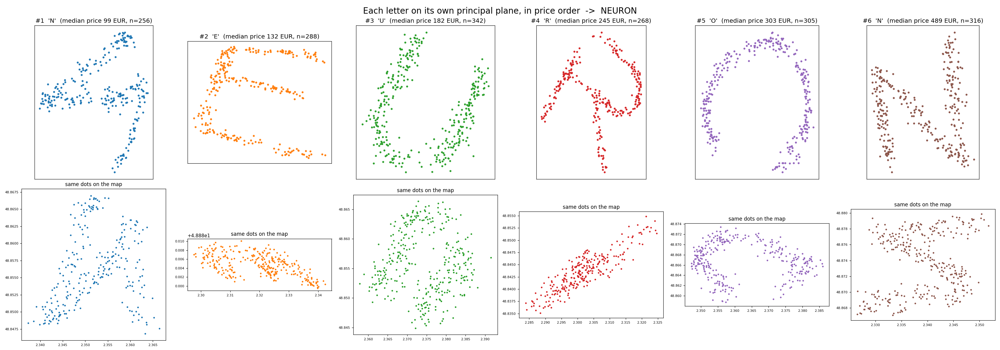

# Point par point — solution

**Flag: `SIGMOID_NEURON`**

## How the letters were hidden

Each planted dot sits on a letter shape in Paris (latitude/longitude). Its "colour" comes from three things a traveller weighs before booking:

- **price**
- **reviews_per_month** (how popular the listing is)
- **availability_365**

Within one letter, both the position and the colour change smoothly (roughly affinely) along the letter's strokes. So each letter is a thin **2‑D sheet** in the 5‑D space (log price, log reviews/month, availability, lat, lon). Real listings fill that space loosely. One letter's dots are each realistic on their own, and they overlap the city and each other on the map. That's why a plain map, or any single feature, shows nothing. In the caption's words: grey, with several secrets inside.

## Method (`solve.py`)

1. **Pointillist space.** Standardise `[log(price), log(reviews_per_month), availability_365, latitude, longitude·cos(48.86°)]`.
2. **Separate the letters from the city.** The log distance to the 10th nearest neighbour is clearly **bimodal** (left panel of `figures/separation.png`). The low mode, `log d10 < -1.4`, gives 1,803 planted dots.
3. **One cluster per letter.** DBSCAN (`eps=0.3`, `min_samples=4`) on the planted dots finds 6 connected sheets of 256–342 dots each. Fragments under 50 dots (28 dots in all) are dropped. The result is the same for any `eps` from 0.25 to 0.4.
4. **Look at each letter.** Each sheet is about 95% two‑dimensional (PCA: PC1+PC2 explain 0.92–0.95 of the variance). Projecting a letter onto its own principal plane removes the ~150 m location noise, and the glyph appears. The axes are only flipped or swapped so the letters read upright.
5. **The artist's order.** Sort the letters by median price, cheapest first:

| # | median price (EUR) | dots | letter |
|---|---|---|---|
| 1 | 99 | 256 | N |
| 2 | 132 | 288 | E |
| 3 | 182 | 342 | U |
| 4 | 245 | 268 | R |
| 5 | 303 | 305 | O |
| 6 | 489 | 316 | N |

→ **NEURON** — fitting for a sigmoid.

Letter #1 is the noisiest. Its colour (cheap, rarely available, few reviews) sits in the densest part of the real data. Its map view (second row of the figure) still shows the N's three strokes.

## Files

- `solve.py`: the full pipeline. Run it with `python solve.py` (needs pandas, numpy, scikit-learn, matplotlib).
- `labels.csv`: one row per listing, with `listing_id`, `is_letter`, `letter_cluster` (0–5 in the artist's order, −1 for the city), `letter`, `log_knn10_distance`.
- `figures/letters.png`: each letter on its principal plane and on the map, in order.
- `figures/separation.png`: the bimodal density score, the raw city, and the separated letter dots.
To reproduce, run `python solve.py` from this folder (it reads `paris_listings.csv` next to it).
